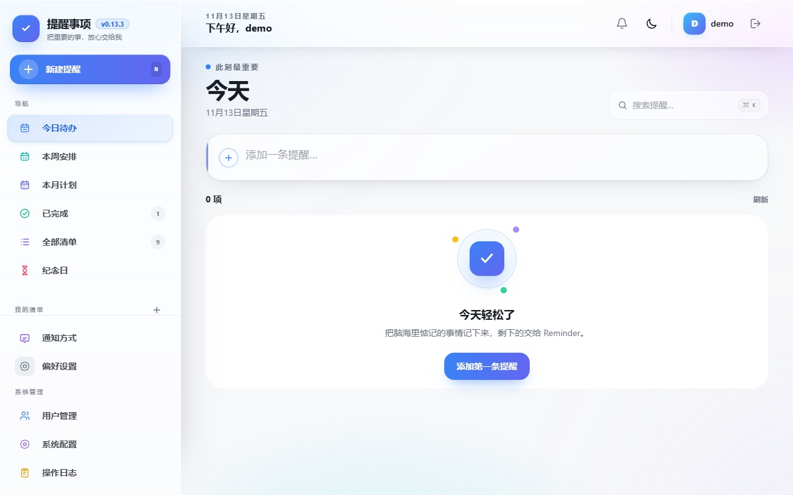
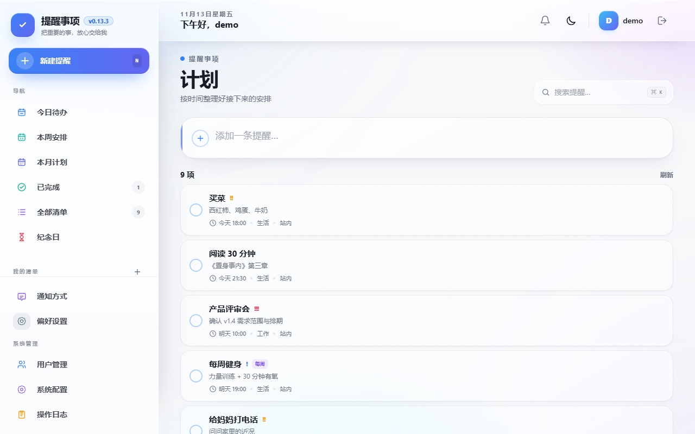
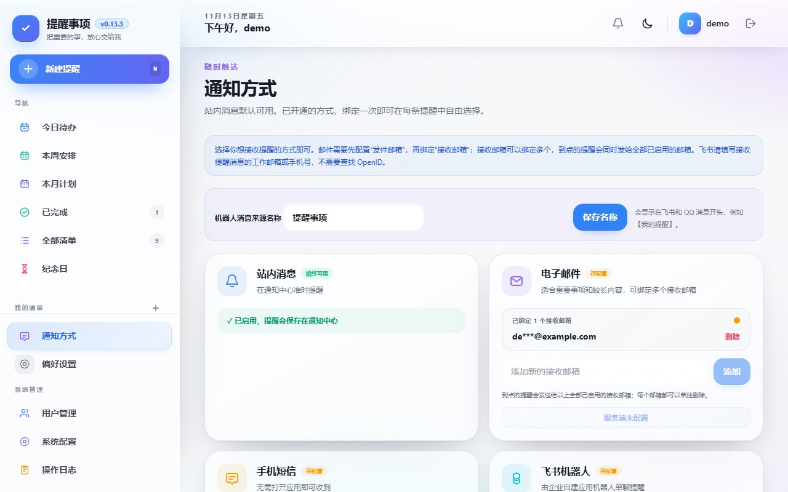
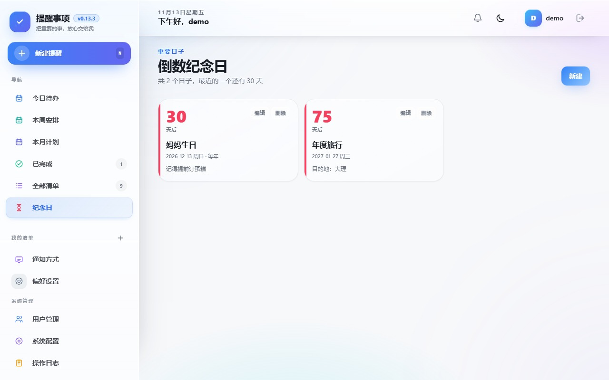
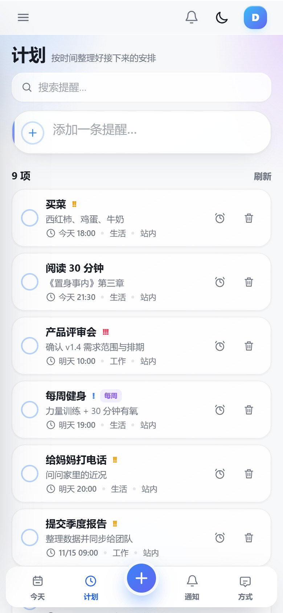
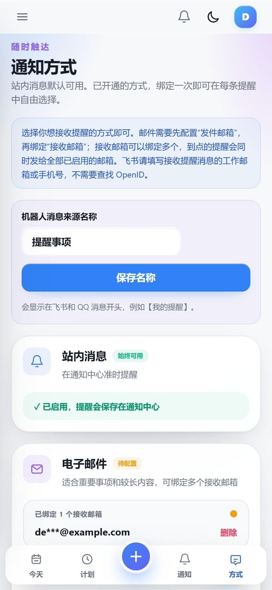

# 提醒事项（Reminder）

一款面向中国大陆用户的轻量多渠道提醒应用：单二进制部署、本地 SQLite 存储、数据完全掌握在自己手里。
界面借鉴移动端提醒工具的低学习成本——清单、今天 / 计划 / 本周 / 本月 / 全部 / 已完成视图、重复提醒、
稍后提醒，并通过站内、邮件、短信、飞书、QQ、钉钉和 Bark 把提醒送到你手边。

- **单进程、单端口**：Go 后端内嵌 Vue 前端，一个二进制、一个 8906 端口即可运行。
- **零外部依赖**：SQLite（WAL）存全部数据，不需要 MySQL、Redis 或消息队列。
- **通知不丢**：提醒先落库为投递任务，调度器幂等领取，失败分类并最多重试三次。
- **日历打通**：支持 ICS 订阅下发到系统日历；钉钉日程通过 CalDAV 单向导入。
- **隐私默认优先**：匿名统计与赞赏入口默认关闭，不向任何服务器上报数据。

版本功能与修复记录见 [CHANGELOG.md](./CHANGELOG.md)，开发约定与目录职责见 [AGENTS.md](./AGENTS.md)。

> **关于本仓库**：这是 [TechFunWay/reminders](https://github.com/TechFunWay/reminders) 的独立发行分支，
> 基于上游 v0.3.0（MIT 许可）二次开发。本分支自行维护发行标识、版本号与隐私默认值，功能改动见 CHANGELOG。
> 上游项目及其作者不对本分支的发行物负责。
>
> **官方部署形态：Docker。** 本分支已移除飞牛 fnOS 集成（网关免登、应用包、安装向导），
> 只保留标准的 TCP 监听与用户名密码登录；如需裸机运行，可按「构建与发布」自行编译。

## 界面预览

| PC 端：今天 | PC 端：计划 |
| --- | --- |
|  |  |

| PC 端：通知方式 | PC 端：倒数纪念日 |
| --- | --- |
|  |  |

| 手机端：计划 | 手机端：通知方式 |
| --- | --- |
|  |  |

界面为 Apple 液态玻璃（Liquid Glass）风格，跟随系统深浅色切换；适配桌面与移动端的响应式布局，
并为「降低透明度」「减少动态效果」以及不支持 `backdrop-filter` 的浏览器准备了降级样式。

## 快速开始

### 使用 Docker（推荐）

```bash
docker run -d --name reminders -p 8906:8906 \
  -v reminders-data:/app/data \
  ghcr.io/kid941005/reminders:latest
```

或使用仓库自带的 compose：

```bash
docker compose up -d
```

启动后访问 `http://<主机>:8906`，**第一个注册的账号自动成为管理员**。

> **镜像说明**
>
> - 镜像托管在 GitHub Container Registry（ghcr.io），目前只构建 `linux/amd64`。
> - **首次发布后包默认是私有的**：需要到仓库 → Packages → `reminders` → Package settings 把可见性改为
>   Public，匿名用户才能直接拉取；私有状态下需先 `docker login ghcr.io`。
> - 数据卷挂载到容器内 `/app/data`（数据库、上传文件、日志），删除容器不会丢数据。

### 自行构建二进制包（可选）

仓库 CI 只构建镜像并创建 Release，**Release 页面不附带预编译二进制附件**。需要各平台压缩包时，
可在本地执行 `make package PACKAGE_TARGET=apps` 自行生成（见「构建与发布」）。

## 功能一览

### 清单与提醒

- 默认清单 + 自定义清单，支持排序、颜色与图标；
- 今天、计划、本周、本月、全部、已完成、单日视图，复用同一套列表与编辑能力；
- 快捷新增、编辑、删除、完成、恢复；操作即时生效，多标签页通过 SSE 自动同步；
- 每天 / 每周 / 每月 / 每年重复，支持公历与农历（生日、纪念日按农历推算）；
- 稍后提醒（10 分钟）、提前提醒（默认提前 15 分钟，全天提醒按整天处理）、过期提醒次数上限；
- 优先级与备注，支持按清单归档与检索。

### 通知渠道

- **站内通知**：始终可用，通知中心保存全部消息，支持未读计数与一键已读；
- **SMTP 邮件**：可绑定多个接收邮箱，适合重要事项与长内容；
- **短信 HTTP 网关**：对接自有短信服务商，无需打开应用即可收到；
- **飞书企业自建应用**：机器人单聊，填写工作邮箱或手机号即可，无需查找 OpenID；
- **QQ 机器人**：主动单聊，通过绑定码完成账号关联；
- **钉钉群自定义机器人**：支持「自定义关键词」与「加签」两种安全设置；
- **Bark（iOS）**：支持官方服务与自建服务器，推送归档到 Bark 历史。

渠道接收目标与密钥在数据库中使用 AES-GCM 加密，接口只返回脱敏值（如 `de***@example.com`）。

### 日历与节假日

- **ICS 订阅**：把未完成提醒与纪念日生成只读日历，可添加到系统日历、Google Calendar、Outlook，
  订阅地址可随时重置（旧地址立即失效）；
- **钉钉日程单向导入（CalDAV）**：填写钉钉「日历设置 → CalDAV 同步」生成的账号密码，日程会导入到
  「钉钉日程」清单；只读，本地改动不会写回钉钉；每 30 分钟同步一次，窗口默认前 7 天、后 180 天；
- **法定节假日与调休**：日历直接标出「休 / 班」，数据随二进制内置、离线可用；次年安排公布前会提示
  尚未公布，不会把未覆盖日期当作普通工作日。

### 天气提醒

- **和风天气每日推送**：在「偏好设置 → 天气提醒」选择城市与推送时间（默认 08:00），每天上午推送
  当天天气与未来三天预报；有降雨、降雪或气象预警时，标题会标出「（有雨）/（有雪）/（有预警）」；
- 内容包含当前实况、今日温度区间与降水概率、未来三天逐日天气（含带伞提示）以及当前生效的
  气象预警（最多 3 条，自动过滤已取消/已过期）；
- 城市支持搜索回填经纬度；站内通知始终开启，邮件、短信、飞书、QQ、钉钉、Bark 需先在
  「通知方式」完成绑定；
- 管理员在设置页统一填写和风天气 API Host 与 API Key（AES-GCM 加密，接口不回显），也可用
  环境变量 `QWEATHER_API_HOST` / `QWEATHER_API_KEY` 提供；
- 以本地日期做幂等，重启后不会重复推送（多实例部署为尽力而为）；推送时间后 4 小时内仍会补推，失败最多每 30 分钟重试一次。

### 账号与系统

- 用户名密码登录，首个账号为管理员；管理员可关闭注册、重置密码、禁用账号、查看操作日志；
- API Key 认证，方便脚本、快捷指令、Home Assistant 等自动化调用；
- 系统配置中心：站点标题/描述、注册开关、登录开关、默认通知渠道、全天提醒时间、订阅是否含节日等；
- 浅色 / 深色主题与响应式手机界面，主题支持「跟随系统」。

## 通知渠道配置

站内通知无需配置。邮件、短信、飞书、QQ 需要在服务端提供渠道凭证（环境变量），用户在「通知方式」
页面绑定自己的接收目标后才能启用。

```text
# 邮件（SMTP）
SMTP_HOST
SMTP_PORT
SMTP_USERNAME
SMTP_PASSWORD
SMTP_FROM_NAME
SMTP_FROM_ADDRESS

# 短信 HTTP 网关
SMS_WEBHOOK_URL
SMS_WEBHOOK_TOKEN

# 飞书企业自建应用
FEISHU_APP_ID
FEISHU_APP_SECRET
FEISHU_BASE_URL

# QQ 机器人
QQ_BOT_APP_ID
QQ_BOT_APP_SECRET
QQ_BOT_API_BASE

# 和风天气（也可在管理员设置页填写）
QWEATHER_API_HOST
QWEATHER_API_KEY

# 可选：单独的数据加密密钥
REMINDER_DATA_KEY
```

- 未设置 `REMINDER_DATA_KEY` 时，会从安装实例的内部 JWT 密钥派生独立的加密密钥。
- 钉钉群机器人与 Bark 由用户在页面自行填写 Webhook / 设备地址，不需要服务端环境变量。

### 钉钉个人提醒

无需创建钉钉应用，也不需要配置服务器环境变量。请使用 Windows 或 Mac 的钉钉电脑端操作（手机端不能创建）：

1. 新建一个专用提醒群，或打开一个现有群；
2. 如果不希望其他人看到提醒，请让群内只保留自己；
3. 群设置 → 群机器人 → 添加「自定义机器人」；
4. 安全设置二选一：
   - **自定义关键词**：填写 `提醒`（应用发出的每条消息都固定包含这两个字）；
   - **加签**：复制以 `SEC` 开头的密钥，连同 Webhook 一起填写，服务端会为每次请求计算 `timestamp` 与 `sign`；
5. 在应用「通知方式 → 钉钉群机器人」粘贴 Webhook（加签模式再填密钥），发送测试。

提醒会发送给该群的当前成员；群内只有你一人时只有你能收到。每位用户的 Webhook 与密钥独立加密保存，
应用只接受钉钉官方机器人地址。

### Bark 推送（iPhone）

1. 在 iPhone 安装 Bark 并打开，首页会显示形如 `https://api.day.app/AbCdEfGhijk` 的推送地址；
2. 在应用「通知方式 → Bark」粘贴整条地址并发送测试；
3. 自建服务器同样支持：`https://bark.example.com/你的设备Key`。

只填到设备 Key 为止，不要带查询参数或子路径。设备 Key 加密保存，页面只显示主机名与 Key 末四位。

## API 与自动化

所有接口返回统一信封 `{ code, message, data }`，`code` 为 `0` 表示成功。

认证方式二选一：

- `Authorization: Bearer <JWT>`（登录后获得，浏览器默认使用）；
- `X-API-Key: <API Key>`（长期凭证，在「个人信息」页查看与重置）。

> API Key 等同于账号密码，可调用该账号的全部接口，请妥善保管；重置后旧 Key 立即失效。

```bash
# 查询今天到期的提醒
curl -H "X-API-Key: $REMINDER_API_KEY" \
  "http://127.0.0.1:8906/api/reminder/items?view=today"

# 新建一条提醒（不传 due_at 则只进「全部」清单）
curl -X POST "http://127.0.0.1:8906/api/reminder/items" \
  -H "X-API-Key: $REMINDER_API_KEY" \
  -H "Content-Type: application/json" \
  -d '{"title":"买牛奶","notes":"顺便买鸡蛋","due_at":"2026-11-14T09:00:00+08:00","priority":2}'

# 标记完成 / 稍后提醒
curl -X POST -H "X-API-Key: $REMINDER_API_KEY" \
  "http://127.0.0.1:8906/api/reminder/items/12/complete"
```

常用接口：

| 分组 | 接口 |
| --- | --- |
| 健康与版本 | `GET /api/health`、`GET /api/version` |
| 认证 | `GET /api/auth/setup-required`、`POST /api/auth/register`、`POST /api/auth/login`、`POST /api/auth/logout`、`GET /api/auth/me`、`PUT /api/auth/password`、`POST /api/auth/apikey` |
| 清单 | `GET/POST /api/reminder/lists`、`PATCH/DELETE /api/reminder/lists/:id` |
| 提醒 | `GET/POST /api/reminder/items`、`GET/PUT/DELETE /api/reminder/items/:id`、`POST /api/reminder/items/:id/{complete,restore,snooze}` |
| 汇总与实时 | `GET /api/reminder/summary`、`GET /api/reminder/revision`、`GET /api/reminder/events`（SSE） |
| 通知中心 | `GET /api/reminder/notifications`、`GET /api/reminder/notifications/unread-count`、`POST /api/reminder/notifications/:id/read`、`POST /api/reminder/notifications/read-all` |
| 纪念日 | `GET/POST /api/reminder/countdowns`、`PUT/DELETE /api/reminder/countdowns/:id` |
| 通知方式 | `GET /api/reminder/channels`、`PUT/PATCH/DELETE /api/reminder/channels/:channel`、`POST /api/reminder/channels/:channel/test`、`POST /api/reminder/channels/qq/bind-code` |
| 天气 | `GET/PUT/DELETE /api/reminder/weather`、`POST /api/reminder/weather/run`、`GET /api/reminder/weather/preview`、`GET /api/reminder/weather/locations?q=` |
| 日历 | `GET /api/reminder/feed`、`POST /api/reminder/feed/reset`、`GET /api/reminder/feed.ics?token=...`、`GET/PUT/DELETE /api/reminder/calendar-sync`、`POST /api/reminder/calendar-sync/run` |
| 节假日与农历 | `GET /api/reminder/holidays`、`GET /api/reminder/lunar`、`GET /api/reminder/lunar/convert` |
| 管理 | `GET /api/users`、`PUT/DELETE /api/users/:id`、`PUT /api/users/:id/status`、`PUT /api/users/:id/password`、`GET /api/audit-logs`、`GET /api/audit-logs/export`、`GET /api/reminder/admin/deliveries`、`GET /api/reminder/admin/providers`、`PUT /api/reminder/admin/providers/:provider`、`GET/PUT /api/reminder/admin/weather` |

`GET /api/reminder/feed.ics?token=...` 是免登录的日历订阅入口，token 由系统生成、可重置；
其余接口都需要认证。

## 配置参考

### 命令行参数

| 参数 | 默认值 | 说明 |
| --- | --- | --- |
| `-port` | `8906` | 服务监听端口（环境变量 `PORT`） |
| `-data-dir` | `./data` | 数据目录：数据库、上传文件、日志（环境变量 `DATA_DIR`） |
| `-web-dir` | `./` | 前端静态文件目录 |
| `-upload-dir` | `<data-dir>/uploads` | 上传文件目录 |
| `-logmode` | `release` | `release` 或 `debug`（环境变量 `ENV`） |
| `-rate-limit` | `20` | 公开接口每分钟最大请求数，`0` 表示不限（环境变量 `RATE_LIMIT`） |
| `-cors-origin` | `*` | 允许的 CORS 来源（环境变量 `CORS_ORIGIN`） |
| `-log-retention-days` | `30` | 日志保留天数，`0` 表示永久（环境变量 `LOG_RETENTION_DAYS`） |
| `-log-console` | `false` | 同时把日志输出到终端（环境变量 `LOG_CONSOLE`） |
| `-device-type` | 空 | 部署形态标识（如 `docker`），仅用于匿名统计 |
| `-disable-stats` | `true` | 关闭匿名统计；设为 `false`（或 `DISABLE_STATS=0`）才可能上报 |
| `-reset-admin-password` | — | 将管理员密码重置为 `admin123` 后退出 |
| `-version` / `-help` | — | 显示版本 / 帮助后退出 |

环境变量优先级高于命令行参数。所有时间语义固定为 `Asia/Shanghai`（二进制内嵌 IANA 时区库，
不依赖宿主机的 zoneinfo）。

### 数据目录

```text
<data-dir>/
├── db/reminder.db     # SQLite 主库（WAL 模式，旁边可能有 -wal / -shm）
├── uploads/           # 上传文件目录（对应 /api/upload 接口）
└── logs/              # 按日期与级别切分的运行日志
```

备份即复制整个 `<data-dir>`（建议先停止容器，确保 WAL 已合并）。恢复时把目录放回原位置即可。

## 运行日志

日志默认只写入 `<data-dir>/logs/`，按日期和级别分为 `info-YYYY-MM-DD.log`、`warn-YYYY-MM-DD.log`、
`error-YYYY-MM-DD.log` 与 `audit-YYYY-MM-DD.log`，默认保留 30 天。这样通知通道或后台任务的重复错误
不会刷屏终端；需要排查时直接查看对应文件。本地调试可用 `-log-console` 或 `LOG_CONSOLE=true` 同时输出到终端。

## 匿名统计与隐私

本发行版**默认不向任何服务器上报数据**，也不展示赞赏入口。

- **统计默认关闭**：`-disable-stats` 默认 `true`，且代码内不内置上报端点。只有同时满足「显式开启统计」
  与「配置 `STATS_ENDPOINT`」两个条件才会发出请求，否则进程不产生任何对外连接。
- **赞赏入口默认关闭**：上游内置的微信收款码属于原作者，本发行版不显示启动弹窗、顶部横幅与偏好设置卡片
  （开关在 `web/src/stores/support.ts` 的 `SUPPORT_ENABLED`）。要为自己的发行版启用，需替换
  `web/src/assets/donate-wechat.png` 并准备接收端。
- **如需自行接入统计**：设置 `STATS_ENDPOINT`，并用 `-disable-stats=false` 或 `DISABLE_STATS=0` 开启；
  上报内容仅为哈希后的设备标识、操作系统、架构、部署形态与版本号，不含用户名、主机名、提醒内容或 IP 明文。

## 本地开发

要求：Go 1.26+、Node.js 20+、CGO 与本地 C 编译器（SQLite 驱动需要）。

```bash
# 构建 Vue 前端、复制到后端静态目录、构建并启动 Go 后端
make dev
```

浏览器访问 `http://localhost:8906`。开发模式只启动 Go 后端一个服务，API 与前端共用 8906 端口；
首次运行会自动安装前端依赖。可用 `PORT=9000 make dev` 临时改端口。

需要邮件、短信、飞书或 QQ 时，先复制 `.env.example` 为 `.env` 并填入服务端凭证，再运行 `make dev`。
`.env` 只在本地启动时读取，且不会覆盖已经设置的系统环境变量。

仅构建或启动已构建产物：

```bash
make build     # 前端 + 后端
make start     # 启动 build/reminder
```

## 构建与发布

```bash
# 后端测试（需要 CGO）
cd server && go test ./...

# 前端构建（vue-tsc 类型检查 + vite 打包）
cd web && npm run build

# 生成各平台压缩包：release/<version>/
make package PACKAGE_TARGET=apps

# 构建本地 Docker 镜像
make package PACKAGE_TARGET=docker
```

- `PACKAGE_TARGET=apps` 会产出 linux/darwin/windows 的压缩包；其中 Linux 目标在
  `golang:1.26-alpine` 容器内编译（需要本机 Docker），macOS/Windows 目标需要对应的交叉编译器。
- **打 tag 推送后，CI 自动构建并推送 `linux/amd64` 镜像、创建 Release**（发布说明取自 CHANGELOG），
  无需本地执行上述打包命令。
- 发版前必须同步 `VERSION`（带 `v`）与 `app.json`（不带 `v`），并在 `CHANGELOG.md` 顶部新增版本小节；
  数据库迁移版本只升不降，缺少版本号会导致预埋迁移不执行。

## 项目结构

| 目录 | 职责 |
| --- | --- |
| `server/apps/` | 应用注册表，功能模块通过 `init()` 注册，不往 `server.go` 堆代码 |
| `server/server/` | 进程启动、路由装配、中间件链、优雅退出 |
| `server/reminder/` | 核心业务：清单、提醒、重复规则、投递调度、通知渠道、日历 |
| `server/user/` `server/auth/` | 账号、角色、JWT、密码与 API Key |
| `server/sysconfig/` | 配置中心（系统级 + 用户级） |
| `server/database/` | 建库、AutoMigrate、版本化数据迁移 |
| `server/middleware/` | 日志、CORS、限流、gzip、静态缓存、认证 |
| `server/stats/` `server/audit/` | 匿名统计（默认关闭）与操作审计日志 |
| `web/src/api/` | 所有 HTTP 调用集中在此，页面不直接写 `axios` |
| `web/src/stores/` | Pinia：`auth`、`theme`、`support` |
| `scripts/` | 各平台打包与本地 Docker 构建脚本 |

## 常见问题

**第一个账号注册后如何再添加用户？**
管理员在「系统配置」打开 `allow_register` 后，其他用户即可自行注册；也可以由管理员在「用户管理」创建。

**忘记管理员密码怎么办？**
在服务器上执行 `./reminder -data-dir <数据目录> -reset-admin-password`，会把管理员密码重置为
`admin123` 后退出；随后用该密码登录并立即修改。

**镜像拉取提示无权限 / 403？**
ghcr 包首次发布默认私有，请按「快速开始」的说明把包可见性改为 Public，或先 `docker login ghcr.io`。

**会提供 arm64 镜像吗？**
目前不提供。CI 仅构建 `linux/amd64` 镜像；如需其它架构，可自行交叉编译或基于仓库 Dockerfile 构建。

**从上游或飞牛版本迁移？**
本分支不再提供飞牛应用包，也无法在飞牛应用中心安装。原部署的 SQLite 数据文件
（`<data-dir>/db/reminder.db`）格式未变，复制到 Docker 数据卷即可继续使用；飞牛账号绑定关系已随功能移除，
迁移后需用原应用账号密码登录。

**为什么日志不在终端输出？**
运行日志默认写文件，避免重复错误刷屏。排查时加 `-log-console` 或设置 `LOG_CONSOLE=true`。

**数据会离开服务器吗？**
默认不会。统计上报需要同时开启开关并配置 `STATS_ENDPOINT`，否则进程不发起任何外部请求；
日历订阅、钉钉同步与天气提醒只在用户主动配置后访问对应服务。

## 安全建议

- 首次登录后立即修改管理员密码，不要使用 `admin123`；
- 通过 HTTPS 反向代理（Nginx / Caddy / Traefik）对外提供服务，不要直接暴露 8906 明文端口；
- 按需收紧 `CORS_ORIGIN` 与 `RATE_LIMIT`；
- `REMINDER_DATA_KEY` 一旦设置请妥善备份，丢失后已加密的渠道目标无法解密；
- API Key 等同于账号密码，泄露后请立即在「个人信息」页重置。

## 致谢与许可

本项目基于 [TechFunWay/reminders](https://github.com/TechFunWay/reminders)（MIT 许可）二次发行，
原始版权归其作者所有；节假日数据来自 [vsme/chinese-days](https://github.com/vsme/chinese-days)（MIT），
农历计算使用 [6tail/lunar-go](https://github.com/6tail/lunar-go)。

本分支的改动与发行物由本仓库维护者负责，与上游项目无关。完整许可条款见 [LICENSE](./LICENSE)。