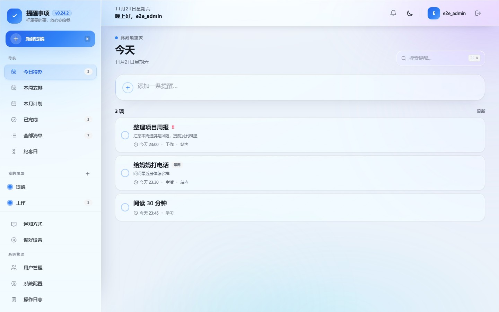
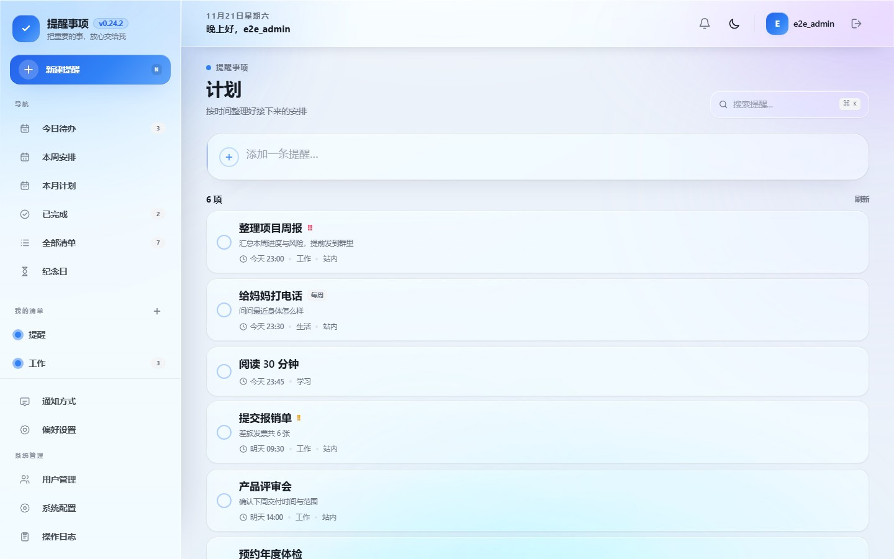
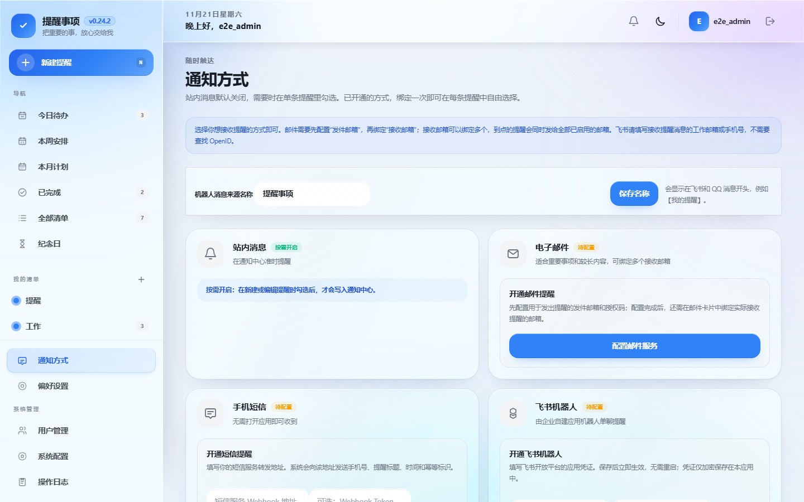
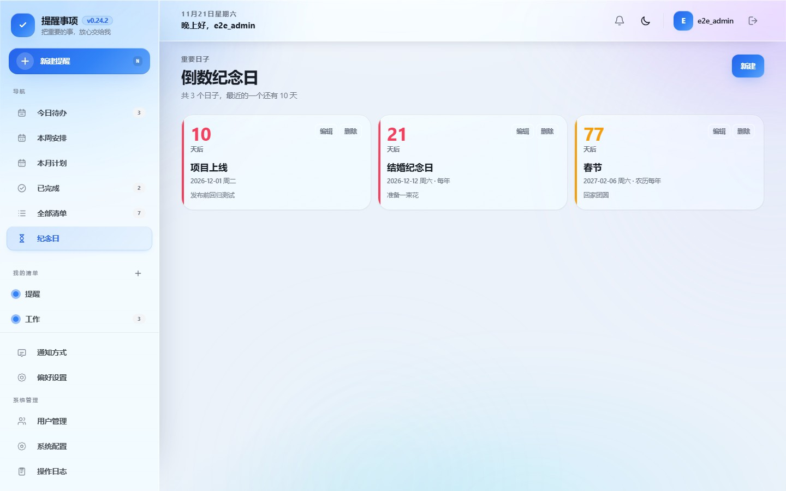
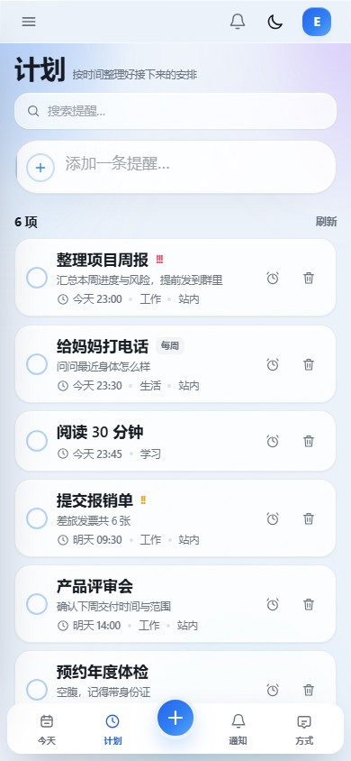
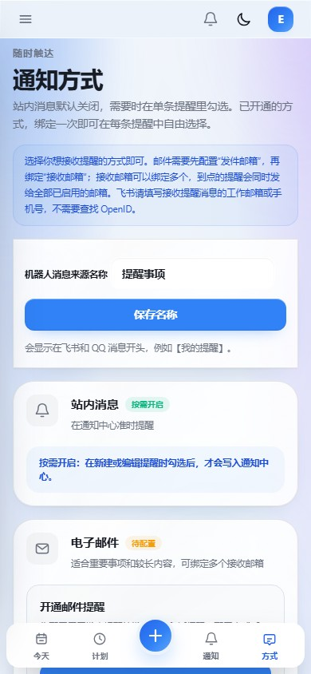

<div align="center">

# 提醒事项 · Reminder

**把重要的事，放心交给我。**

一款面向个人与家庭的自托管提醒应用：清单、重复提醒、倒数纪念日、天气、日历与多渠道通知，单二进制部署，数据留在自己手里。

[](https://github.com/kid941005/reminders/releases)
[](https://github.com/kid941005/reminders/actions/workflows/ci.yml)
[](https://go.dev/)
[](https://vuejs.org/)
[](https://github.com/kid941005/reminders/pkgs/container/reminders)
[](./LICENSE)

[快速开始](#快速开始) · [功能](#功能) · [界面预览](#界面预览) · [API](#api-与自动化) · [部署](#部署与运维) · [常见问题](#常见问题)

</div>

---

## 为什么选择提醒事项

- **一个二进制，零外部依赖**：Go 后端内嵌 Vue 前端，一个进程、一个 `8906` 端口即可运行；数据全部保存在本地 SQLite（WAL），不需要 MySQL、Redis 或消息队列。
- **提醒真的会到**：提醒先落库为投递任务，调度器幂等领取，失败按类型退避并最多重试三次，重启不丢任务。
- **渠道覆盖日常所需**：站内、邮件、短信、飞书、QQ、钉钉、Bark 七种通知方式，按提醒自由勾选。
- **和自己已有的工具打通**：ICS 日历订阅、钉钉日程 CalDAV 导入、Apple 提醒事项单向推送、和风天气早晚播报。
- **为长期自托管而设计**：MIT 许可、匿名统计默认关闭、加密保存渠道凭据、数据目录可整包备份与迁移。

版本记录见 [CHANGELOG.md](./CHANGELOG.md)，开发约定与目录职责见 [AGENTS.md](./AGENTS.md)。

> **关于本仓库**
>
> 本仓库是 [TechFunWay/reminders](https://github.com/TechFunWay/reminders) 的独立发行分支，基于上游 v0.3.0（MIT 许可）二次开发。
> 本分支自行维护版本号、发行标识与隐私默认值，功能改动见 CHANGELOG；上游项目及其作者不对本分支的发行物负责。
>
> **官方部署形态为 Docker。** 本分支已移除飞牛 fnOS 集成（网关免登、应用包、安装向导），只保留标准 TCP 监听与用户名密码登录；
> 如需裸机运行，可按[本地开发](#本地开发)或[构建与发布](#构建与发布)自行编译。

## 界面预览

| 今天 | 计划 |
| --- | --- |
|  |  |

| 通知方式 | 倒数纪念日 |
| --- | --- |
|  |  |

| 手机端：计划 | 手机端：通知方式 |
| --- | --- |
|  |  |

界面采用 Apple 液态玻璃（Liquid Glass）风格：真实边缘折射、极细镜面高光与低饱和环境光，支持浅色 / 深色 / 跟随系统。
玻璃效果可在「偏好设置 → 液态玻璃效果」中随时关闭；同时为「降低透明度」「减少动态效果」、移动端触摸设备和不支持 `backdrop-filter` 的浏览器准备了实色与静态回退。

## 快速开始

### 使用 Docker（推荐）

```bash
docker run -d --name reminders \
  --restart unless-stopped \
  -p 8906:8906 \
  -v reminders-data:/app/data \
  ghcr.io/kid941005/reminders:latest
```

或使用仓库自带的 Compose：

```bash
docker compose up -d
```

启动后访问 `http://<主机IP>:8906`，**第一个注册的账号自动成为管理员**。请立即修改管理员密码，再按需关闭注册或创建其他账号。

### 镜像与版本

- 镜像发布在 GitHub Container Registry：`ghcr.io/kid941005/reminders`，目前只构建 `linux/amd64`。
- 可用标签：`latest`、`0.24.2`。生产环境建议固定到具体补丁版本（如 `0.24.2`），升级前先看 CHANGELOG。
- **首次发布后 GHCR 包默认是私有的**：需要到仓库 → **Packages** → `reminders` → **Package settings** 把可见性改为 **Public**，匿名用户才能直接拉取；私有状态下需先 `docker login ghcr.io`。
- 若仓库配置了 Secrets `DOCKERHUB_USERNAME` 与 `DOCKERHUB_TOKEN`，打 tag 时会同步推送到 Docker Hub 的 `<命名空间>/reminders`（`0.x.y`、`latest`）。
- 数据卷必须挂载到容器内 `/app/data`（数据库、上传文件、日志都在这里），删除容器不会丢数据。

> **Release 说明**：GitHub Release 只提供源码与发布说明，**不附带各平台二进制压缩包**；所有发行产物以 `ghcr.io` 镜像为准。

## 功能

### 清单与提醒

- 默认清单 + 自定义清单，支持颜色、图标与排序；清单可新建、重命名、删除。
- 今天 / 计划 / 本周 / 本月 / 全部 / 已完成 / 单日视图，共用同一套列表、筛选与编辑能力。
- 快捷新增、编辑、删除、完成、恢复；多标签页通过 SSE 实时同步，操作即时生效。
- 每天 / 每周 / 每月 / 每年重复，可切换公历或农历（农历适合生日、传统节日与纪念日）。
- 支持优先级、备注、提前提醒、稍后提醒（10 分钟）与过期提醒次数上限。
- 搜索、按清单归档、按时间排序；提供键盘快捷键与移动端底部导航。

### 通知渠道

- **站内通知**：默认关闭，按需开启；在单条提醒中勾选后才推送。通知中心保存全部消息，支持未读计数与一键已读。
- **SMTP 邮件**：可绑定多个接收邮箱，适合重要事项与长内容。
- **短信 HTTP 网关**：对接自有短信服务商，无需打开应用即可收到。
- **飞书企业自建应用**：机器人单聊，填写工作邮箱或手机号即可，无需查找 OpenID。
- **QQ 机器人**：主动单聊，通过绑定码完成账号关联。
- **钉钉群自定义机器人**：支持「自定义关键词」与「加签」两种安全设置。
- **Bark（iOS）**：支持官方服务与自建服务器，推送归档到 Bark 历史。

渠道接收目标与密钥在数据库中使用 AES-GCM 加密，接口只返回脱敏值（如 `de***@example.com`）。

### 日历与外部集成

- **ICS 订阅**：把未完成提醒与纪念日生成只读日历，可添加到系统日历、Google Calendar、Outlook；订阅地址可随时重置，旧地址立即失效。
- **钉钉日程单向导入（CalDAV）**：填写钉钉「日历设置 → CalDAV 同步」生成的账号密码，日程导入到「钉钉日程」清单；只读、不回写，默认每 30 分钟同步一次，窗口为前 7 天、后 180 天。
- **Apple 提醒事项单向推送（CloudKit，推荐）**：用 Apple ID 登录并完成两步验证后选择同步列表；本地新建、修改、完成、删除会写入 iCloud 提醒事项，iPhone / iPad / Mac 原生「提醒事项」可见。凭据加密保存在本地，只单向推送，Apple 端改动不回写。
- **Apple 提醒事项单向推送（CalDAV，兼容旧列表）**：适用于仍保留 iOS 13 之前旧任务列表的账号；填写 Apple ID 与应用专用密码。使用确定性 UID 与 ETag 条件请求避免重复和覆盖冲突，失败自动退避重试。
- **法定节假日与调休**：日历直接标出「休 / 班」，数据随二进制内置、离线可用；次年安排公布前会提示尚未公布，不会把未覆盖日期当作普通工作日。

### 倒数纪念日

- 支持公历与农历纪念日，自动计算「还有多少天 / 已过去多少天」。
- 支持每年重复、置顶展示、颜色强调与备注。
- 纪念日会进入 ICS 订阅，并可在列表中置顶展示。

### 天气提醒

- **和风天气早晚推送**：在「偏好设置 → 天气提醒」选择城市与时间，早间（默认 08:00）只推当天，晚间（默认 20:00）只推次日。
- 标题以天气 emoji 开头（☀️ 晴、⛅ 多云、☁️ 阴、🌫️ 雾霾、🌬️ 大风、🌧️ 雨、❄️ 雪、⛈️ 雷、⚠️ 预警），并标注「今日/明日天气 · 城市」。
- 每条只包含目标日的一条温度区间、降水概率与带伞/防滑提示，以及最多 2 条当天生效的气象预警（自动过滤已取消、已过期和不落在目标日的预警）。
- 城市支持搜索回填经纬度；天气推送默认不开启站内通知，启用时至少勾选一个渠道。
- 管理员在设置页统一填写和风天气 API Host 与 API Key（AES-GCM 加密，接口不回显），也可用环境变量 `QWEATHER_API_HOST` / `QWEATHER_API_KEY` 提供。
- 以本地日期 + 时段做幂等，早间成功不会吞掉晚间推送，重启后也不会重复推送；每个时段在计划时间后 4 小时内仍会补推，失败最多每 30 分钟重试一次。

### 账号、安全与运维

- 用户名密码登录，首个账号为管理员；管理员可关闭注册、重置密码、禁用账号、查看操作日志。
- API Key 认证，方便脚本、快捷指令、Home Assistant 等自动化调用。
- 系统配置中心：站点标题/描述、注册开关、登录开关、日志保留天数等；用户级配置包含主题模式、液态玻璃效果等。
- 浅色 / 深色主题与响应式手机界面，主题支持「跟随系统」。
- 运行日志按日期与级别切分，默认保留 30 天，可在设置页调整或设为永久保留。

### 自动化与语音

- 完整 REST API + SSE 实时事件，所有接口使用统一信封，详见 [API 与自动化](#api-与自动化)。
- 自带 `reminder-mcp/` 适配器，把 REST API 包装为小智设备可用的 MCP 工具，支持语音新增、查询、完成、推迟待办，以及按城市查询天气。

## 通知渠道配置

站内通知无需服务端配置，但默认不开启，需要在单条提醒或天气推送中主动勾选。
邮件、短信、飞书、QQ 需要在服务端（管理员设置或环境变量）提供渠道凭证，用户在「通知方式」页面绑定自己的接收目标后才能启用。

```text
# 邮件（SMTP）
SMTP_HOST
SMTP_PORT
SMTP_USERNAME
SMTP_PASSWORD
SMTP_FROM_NAME
SMTP_FROM_ADDRESS

# 短信 HTTP 网关
SMS_WEBHOOK_URL
SMS_WEBHOOK_TOKEN

# 飞书企业自建应用
FEISHU_APP_ID
FEISHU_APP_SECRET
FEISHU_BASE_URL

# QQ 机器人
QQ_BOT_APP_ID
QQ_BOT_APP_SECRET
QQ_BOT_API_BASE

# 和风天气（也可在管理员设置页填写）
QWEATHER_API_HOST
QWEATHER_API_KEY

# 可选：单独的数据加密密钥
REMINDER_DATA_KEY
```

- 未设置 `REMINDER_DATA_KEY` 时，会从安装实例的内部 JWT 密钥派生独立的加密密钥。
- 钉钉群机器人与 Bark 由用户在页面自行填写 Webhook / 设备地址，不需要服务端环境变量。

### 钉钉个人提醒

无需创建钉钉应用，也不需要服务器环境变量。请使用 Windows 或 Mac 的钉钉电脑端操作（手机端不能创建机器人）：

1. 新建一个专用提醒群，或打开一个现有群；如果不希望其他人看到提醒，请让群内只保留自己。
2. 群设置 → 群机器人 → 添加「自定义机器人」。
3. 安全设置二选一：
   - **自定义关键词**：填写 `提醒`（应用发出的每条消息都固定包含这两个字）；
   - **加签**：复制以 `SEC` 开头的密钥，连同 Webhook 一起填写，服务端会为每次请求计算 `timestamp` 与 `sign`。
4. 在应用「通知方式 → 钉钉群机器人」粘贴 Webhook（加签模式再填密钥），发送测试。

提醒会发送给该群的当前成员；群内只有你一人时只有你能收到。每位用户的 Webhook 与密钥独立加密保存，应用只接受钉钉官方机器人地址。

### Bark 推送（iPhone）

1. 在 iPhone 安装 Bark 并打开，首页会显示形如 `https://api.day.app/AbCdEfGhijk` 的推送地址。
2. 在应用「通知方式 → Bark」粘贴整条地址并发送测试。
3. 自建服务器同样支持：`https://bark.example.com/你的设备Key`。

只填到设备 Key 为止，不要带查询参数或子路径。设备 Key 加密保存，页面只显示主机名与 Key 末四位。

## API 与自动化

所有接口返回统一信封 `{ code, message, data }`，`code` 为 `0` 表示成功。

认证方式二选一：

- `Authorization: Bearer <JWT>`：登录后获得，浏览器默认使用；
- `X-API-Key: <API Key>`：长期凭证，在「个人信息」页查看与重置。

> API Key 等同于账号密码，可调用该账号的全部接口，请妥善保管；重置后旧 Key 立即失效。

```bash
# 查询今天到期的提醒
curl -H "X-API-Key: $REMINDER_API_KEY" \
  "http://127.0.0.1:8906/api/reminder/items?view=today"

# 新建一条提醒（不传 due_at 则只进「全部」清单）
curl -X POST "http://127.0.0.1:8906/api/reminder/items" \
  -H "X-API-Key: $REMINDER_API_KEY" \
  -H "Content-Type: application/json" \
  -d '{"title":"买牛奶","notes":"顺便买鸡蛋","due_at":"2026-11-14T09:00:00+08:00","priority":2}'

# 标记完成 / 稍后提醒
curl -X POST -H "X-API-Key: $REMINDER_API_KEY" \
  "http://127.0.0.1:8906/api/reminder/items/12/complete"
```

常用接口：

| 分组 | 接口 |
| --- | --- |
| 健康与版本 | `GET /api/health`、`GET /api/version` |
| 引导与认证 | `GET /api/bootstrap`、`GET /api/auth/setup-required`、`POST /api/auth/register`、`POST /api/auth/login`、`POST /api/auth/logout`、`GET /api/auth/me`、`PUT /api/auth/password`、`POST /api/auth/apikey` |
| 清单 | `GET/POST /api/reminder/lists`、`PATCH/DELETE /api/reminder/lists/:id` |
| 提醒 | `GET/POST /api/reminder/items`、`GET/PUT/DELETE /api/reminder/items/:id`、`POST /api/reminder/items/:id/{complete,restore,snooze}` |
| 汇总与实时 | `GET /api/reminder/summary`、`GET /api/reminder/revision`、`GET /api/reminder/events`（SSE） |
| 通知中心 | `GET /api/reminder/notifications`、`GET /api/reminder/notifications/unread-count`、`POST /api/reminder/notifications/:id/read`、`POST /api/reminder/notifications/read-all` |
| 倒数纪念日 | `GET/POST /api/reminder/countdowns`、`PUT/DELETE /api/reminder/countdowns/:id` |
| 通知方式 | `GET /api/reminder/channels`、`PUT/PATCH/DELETE /api/reminder/channels/:channel`、`DELETE /api/reminder/channels/:channel/bindings/:id`、`POST /api/reminder/channels/:channel/test`、`POST /api/reminder/channels/qq/bind-code` |
| 天气 | `GET/PUT/DELETE /api/reminder/weather`、`POST /api/reminder/weather/run?slot=morning\|evening`、`GET /api/reminder/weather/preview?slot=morning\|evening`、`GET /api/reminder/weather/query?city=&days=`、`GET /api/reminder/weather/locations?q=` |
| 日历 | `GET /api/reminder/feed`、`POST /api/reminder/feed/reset`、`GET /api/reminder/feed.ics?token=...`、`GET/PUT/DELETE /api/reminder/calendar-sync`、`POST /api/reminder/calendar-sync/run` |
| Apple 提醒事项 | `GET/PUT/DELETE /api/reminder/apple-reminders`、`POST /api/reminder/apple-reminders/discover`、`POST /api/reminder/apple-reminders/run`、`POST /api/reminder/apple-reminders/cloudkit/{login,verify,resend}` |
| 节假日与农历 | `GET /api/reminder/holidays`、`GET /api/reminder/lunar`、`GET /api/reminder/lunar/convert` |
| 系统配置 | `GET /api/configs`、`GET /api/configs/public`、`GET /api/configs/system`、`GET /api/configs/meta`、`GET /api/configs/user/meta`、`PUT /api/configs` |
| 管理 | `GET /api/users`、`PUT/DELETE /api/users/:id`、`PUT /api/users/:id/status`、`PUT /api/users/:id/password`、`GET /api/audit-logs`、`GET /api/audit-logs/export`、`GET /api/reminder/admin/deliveries`、`GET /api/reminder/admin/providers`、`PUT /api/reminder/admin/providers/:provider`、`GET/PUT /api/reminder/admin/weather` |

- `GET /api/reminder/items` 支持可选 `page` / `page_size`（默认 20，最大 100）；带参数时返回 `{items,total,page,pageSize}`，不带时保持原有数组响应以兼容旧调用。
- `GET /api/reminder/feed.ics?token=...` 是免登录的日历订阅入口，token 由系统生成、可重置；其余接口都需要认证。
- 时间字段使用 RFC 3339；服务端统一按 `Asia/Shanghai` 解释，并以内嵌 IANA 时区库保证不同宿主机行为一致。

### 小智语音助手（MCP，可选）

仓库自带 `reminder-mcp/` 适配器，把 REST API 包装成小智设备可用的 MCP 工具，支持语音新增、查询、完成和推迟待办，以及按城市查询和风天气；ESP32 固件无需修改。
Reminder 后端 v0.18.0 及以上均可用；适配器镜像由 GitHub Actions 构建并推送到 `ghcr.io/kid941005/reminders-mcp:latest`。

```bash
cp reminder-mcp/.env.example reminder-mcp/.env
# 编辑 reminder-mcp/.env：填写 Reminder API Key 与小智 MCP 接入点
docker compose --profile mcp pull
docker compose --profile mcp up -d
```

适配器默认不随 `docker compose up -d` 启动。接入点地址、工具行为和常见问题见 [reminder-mcp/README.md](./reminder-mcp/README.md)。

## 配置参考

### 命令行参数

| 参数 | 默认值 | 说明 |
| --- | --- | --- |
| `-port` | `8906` | 服务监听端口（环境变量 `PORT`） |
| `-data-dir` | `./data` | 数据目录：数据库、上传文件、日志（环境变量 `DATA_DIR`） |
| `-web-dir` | `./` | 前端静态文件目录 |
| `-upload-dir` | `<data-dir>/uploads` | 上传文件目录 |
| `-logmode` | `release` | `release` 或 `debug`（环境变量 `ENV`） |
| `-rate-limit` | `20` | 公开接口每分钟最大请求数，`0` 表示不限（环境变量 `RATE_LIMIT`） |
| `-cors-origin` | `*` | 允许的 CORS 来源（环境变量 `CORS_ORIGIN`） |
| `-log-retention-days` | `30` | 日志保留天数，`0` 表示永久（环境变量 `LOG_RETENTION_DAYS`） |
| `-log-console` | `false` | 同时把日志输出到终端（环境变量 `LOG_CONSOLE`） |
| `-device-type` | 空 | 部署形态标识（如 `docker`），仅用于匿名统计 |
| `-disable-stats` | `true` | 关闭匿名统计；设为 `false`（或 `DISABLE_STATS=0`）才可能上报 |
| `-reset-admin-password` | — | 将管理员密码重置为 `admin123` 后退出 |
| `-version` / `-help` | — | 显示版本 / 帮助后退出 |

环境变量优先级高于命令行参数。所有时间语义固定为 `Asia/Shanghai`，不依赖宿主机的 zoneinfo。

### 服务端环境变量

| 变量 | 用途 |
| --- | --- |
| `PORT`、`DATA_DIR`、`DB_PATH`、`ENV` | 端口、数据目录、数据库路径、日志模式 |
| `RATE_LIMIT`、`CORS_ORIGIN` | 公开接口限流、跨域来源 |
| `LOG_RETENTION_DAYS`、`LOG_CONSOLE` | 日志保留与终端输出 |
| `DEVICE_TYPE`、`DISABLE_STATS`、`STATS_ENDPOINT` | 匿名统计相关；默认关闭 |
| `SMTP_*`、`SMS_WEBHOOK_*` | 邮件与短信网关 |
| `FEISHU_*`、`QQ_BOT_*` | 飞书与 QQ 机器人 |
| `QWEATHER_API_HOST`、`QWEATHER_API_KEY` | 和风天气（也可在管理员设置页填写） |
| `REMINDER_DATA_KEY` | 可选的数据加密密钥；设置后请妥善备份 |

### 数据目录

```text
<data-dir>/
├── db/reminder.db     # SQLite 主库（WAL 模式，旁边可能有 -wal / -shm）
├── uploads/           # 上传文件目录（对应 /api/upload 接口）
└── logs/              # 按日期与级别切分的运行日志
```

## 部署与运维

### 升级

```bash
docker compose pull
docker compose up -d
```

或用固定版本：

```bash
docker pull ghcr.io/kid941005/reminders:0.24.2
# 修改 compose 中的 image 后
docker compose up -d
```

> 数据库迁移只升不降。跨版本升级前请先备份整个数据目录；降级镜像不会自动回滚数据库结构。

### 备份与恢复

- 备份：停止容器后复制整个 `<data-dir>`，确保 WAL 已合并；或用 `sqlite3 reminder.db ".backup ..."` 做一致性快照。
- 恢复：把目录放回原位置，重新启动容器。
- 迁移：把同一数据目录挂载到新主机的容器即可，账号、提醒、渠道凭据与日志都会保留。

### 反向代理

建议使用 Nginx / Caddy / Traefik 配置 HTTPS 后对外提供服务，不要直接暴露 `8906` 明文端口。SSE 实时通知要求代理关闭对该路径的缓冲（Nginx 可对 `/api/reminder/events` 设置 `proxy_buffering off`）。

## 本地开发

要求：Go 1.26+、Node.js 20+、CGO 与本地 C 编译器（SQLite 驱动需要）。

```bash
# 构建 Vue 前端、复制到后端静态目录、构建并启动 Go 后端
make dev
```

浏览器访问 `http://localhost:8906`。开发模式只启动 Go 后端一个服务，API 与前端共用 8906 端口；首次运行会自动安装前端依赖。可用 `PORT=9000 make dev` 临时改端口。

需要邮件、短信、飞书或 QQ 时，先复制 `.env.example` 为 `.env` 并填入服务端凭证，再运行 `make dev`。`.env` 只在本地启动时读取，且不会覆盖已经设置的系统环境变量。

仅构建或启动已构建产物：

```bash
make build     # 前端 + 后端
make start     # 启动 build/reminder
```

### 测试

```bash
cd server && go test ./...
cd web && npm run build
```

部分集成测试需要回环网络与本地端口；在受限沙箱中会失败，属于环境限制而非代码问题。

## 构建与发布

```bash
# 后端测试（需要 CGO）
cd server && go test ./...

# 前端构建（vue-tsc 类型检查 + vite 打包）
cd web && npm run build

# 构建本地 Docker 镜像
make package PACKAGE_TARGET=docker
```

- **推送 tag 后，CI 自动构建并推送 `linux/amd64` 镜像、创建 Release**（发布说明取自 CHANGELOG），无需本地打包；配置 Docker Hub 凭据后会同步镜像清单。
- 发版前必须同步 `VERSION`（带 `v`）与 `app.json`（不带 `v`），并在 `CHANGELOG.md` 顶部新增版本小节；数据库迁移版本只升不降，缺少版本号会导致预埋迁移不执行。
- Release 不附带平台二进制，README 与 CI 均以容器镜像为唯一发行产物。

## 项目结构

```text
浏览器 / 手机 / 快捷指令 / 小智语音
              │ HTTP / SSE
              ▼
        Go 单进程（Gin）
  ┌───────────┼───────────┐
  │ 认证与权限 │ 提醒与投递 │ 日历与天气 │
  └───────────┼───────────┘
              ▼
      SQLite WAL + 本地文件日志
              │
              ▼
站内 / 邮件 / 短信 / 飞书 / QQ / 钉钉 / Bark
```

| 目录 | 职责 |
| --- | --- |
| `server/apps/` | 应用注册表，功能模块通过 `init()` 注册，不往 `server.go` 堆代码 |
| `server/server/` | 进程启动、路由装配、中间件链、优雅退出 |
| `server/reminder/` | 核心业务：清单、提醒、重复规则、投递调度、通知渠道、日历、天气 |
| `server/user/` `server/auth/` | 账号、角色、JWT、密码与 API Key |
| `server/sysconfig/` | 配置中心（系统级 + 用户级） |
| `server/database/` | 建库、AutoMigrate、版本化数据迁移 |
| `server/scheduler/` | 定时任务（提醒投递、日历同步、天气推送） |
| `server/security/` | AES-GCM 加密、渠道凭据解密与安全问答 |
| `server/middleware/` | 日志、CORS、限流、gzip、静态缓存、认证 |
| `server/stats/` `server/audit/` | 匿名统计（默认关闭）与操作审计日志 |
| `web/src/api/` | 所有 HTTP 调用集中在此，页面不直接写 `axios` |
| `web/src/stores/` | Pinia：`auth`、`theme`、`support` |
| `web/src/views/` `web/src/components/` | 页面与可复用组件 |
| `web/src/utils/` | 液态玻璃渲染、日期、存储键等工具 |
| `scripts/` | 构建与本地 Docker 构建脚本 |
| `reminder-mcp/` | 小智语音 MCP 适配器 |

## 常见问题

**第一个账号注册后如何再添加用户？**
管理员在「系统配置」打开 `allow_register` 后，其他用户即可自行注册；也可以由管理员在「用户管理」创建。

**忘记管理员密码怎么办？**
在服务器上执行 `./reminder -data-dir <数据目录> -reset-admin-password`，会把管理员密码重置为 `admin123` 后退出；随后用该密码登录并立即修改。

**界面变成实色、没有玻璃效果？**
v0.24.1 起玻璃效果改为应用内开关，不再跟随系统「透明效果」。请在「偏好设置 → 液态玻璃效果」中开启；如果浏览器不支持 `backdrop-filter` 或设备为触摸模式，会自动使用实色回退。

**镜像拉取提示无权限 / 403？**
GHCR 包首次发布默认私有，请按「快速开始」的说明把包可见性改为 Public，或先 `docker login ghcr.io`。

**会提供 arm64 镜像吗？**
目前不提供。CI 仅构建 `linux/amd64` 镜像；如需其它架构，可自行交叉编译或基于仓库 Dockerfile 构建。

**Release 里为什么没有二进制包？**
本分支以容器镜像为唯一发行产物，Release 只提供源码和发布说明；请使用 `ghcr.io/kid941005/reminders`。

**从上游或飞牛版本迁移？**
本分支不再提供飞牛应用包，也无法在飞牛应用中心安装。原部署的 SQLite 数据文件（`<data-dir>/db/reminder.db`）格式未变，复制到 Docker 数据卷即可继续使用；飞牛账号绑定关系已随功能移除，迁移后需用原应用账号密码登录。

**为什么日志不在终端输出？**
运行日志默认写文件，避免重复错误刷屏。排查时加 `-log-console` 或设置 `LOG_CONSOLE=true`。

**数据会离开服务器吗？**
默认不会。统计上报需要同时开启开关并配置 `STATS_ENDPOINT`，否则进程不发起任何外部请求；日历订阅、钉钉同步、Apple 推送与天气提醒只在用户主动配置后访问对应服务。

## 安全与隐私

- 首次登录后立即修改管理员密码，不要使用 `admin123`。
- 通过 HTTPS 反向代理（Nginx / Caddy / Traefik）对外提供服务，不要直接暴露 8906 明文端口。
- 按需收紧 `CORS_ORIGIN` 与 `RATE_LIMIT`。
- `REMINDER_DATA_KEY` 一旦设置请妥善备份，丢失后已加密的渠道目标无法解密。
- API Key 等同于账号密码，泄露后请立即在「个人信息」页重置。
- 本发行版默认不向任何服务器上报数据，也不展示赞赏入口；统计默认关闭，代码内不内置上报端点。
- 如自行接入统计：设置 `STATS_ENDPOINT`，并用 `-disable-stats=false` 或 `DISABLE_STATS=0` 开启。上报内容仅为哈希后的设备标识、操作系统、架构、部署形态与版本号，不含用户名、主机名、提醒内容或 IP 明文。

## 贡献

欢迎提交 Issue 与 Pull Request。参与开发前请先阅读 [AGENTS.md](./AGENTS.md) 中的目录约定、代码风格与发版流程；请勿直接修改生成物（`server/static/dist`、`web/dist`）。

## 致谢与许可

本项目基于 [TechFunWay/reminders](https://github.com/TechFunWay/reminders)（MIT 许可）二次发行，原始版权归其作者所有；
节假日数据来自 [vsme/chinese-days](https://github.com/vsme/chinese-days)（MIT），农历计算使用 [6tail/lunar-go](https://github.com/6tail/lunar-go)。

本分支的改动与发行物由本仓库维护者负责，与上游项目无关。完整许可条款见 [LICENSE](./LICENSE)。
